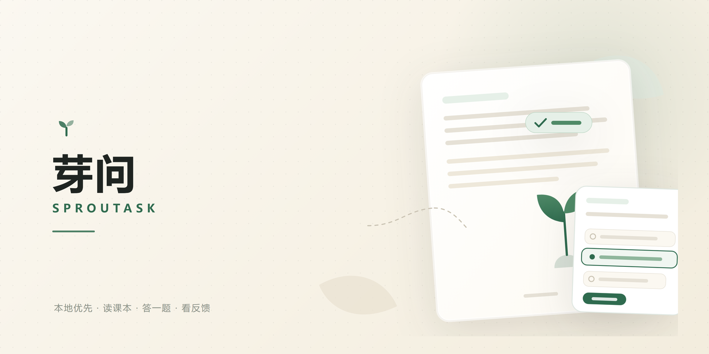
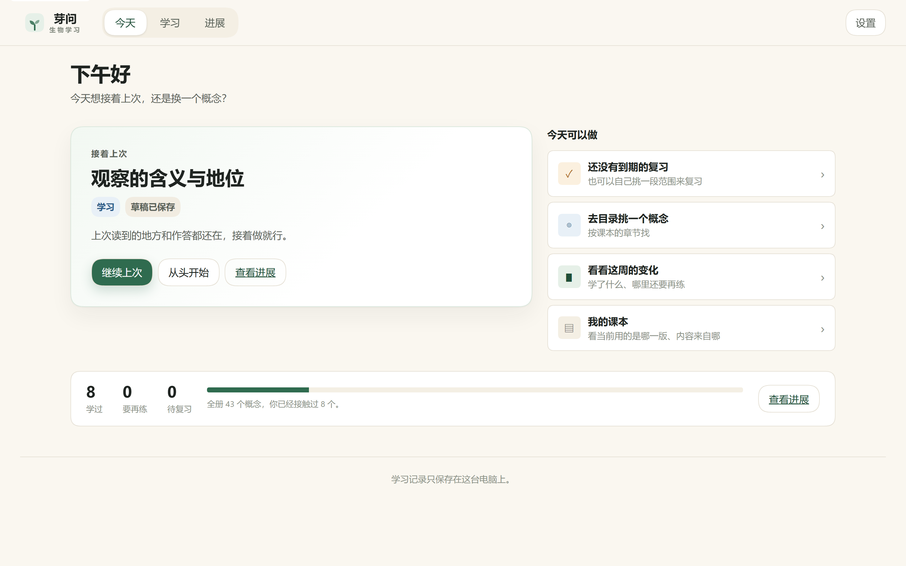
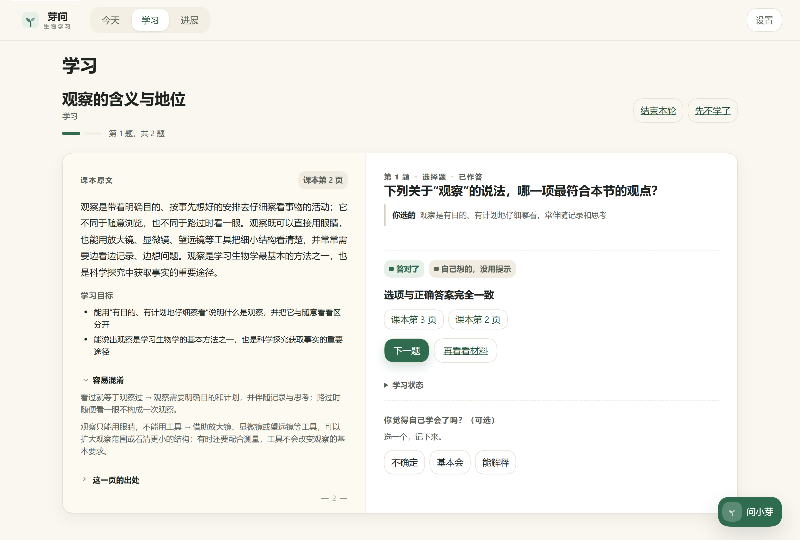
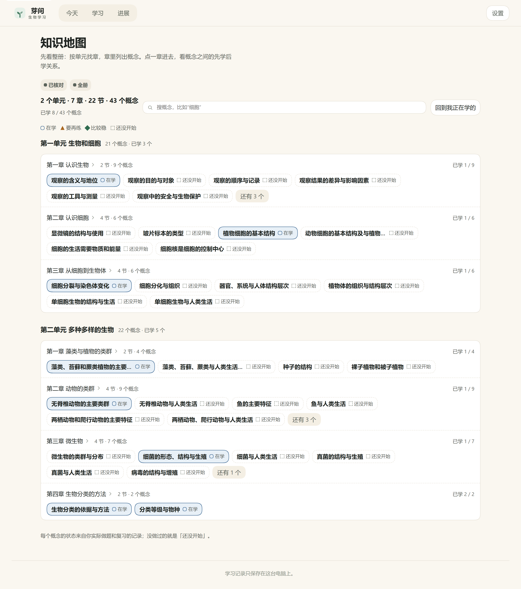

<p align="center">
  
</p>
<p align="center"><sub>Design illustration — not a product screenshot.</sub></p>

<h1 align="center">SproutAsk</h1>
<p align="center">A local-first biology study agent for one student on one Windows PC.</p>
<p align="center"><a href="README.zh.md">中文</a></p>

<p align="center">
  <a href="https://github.com/deepseek-ai/deepseek-harness"></a>
  <a href="https://www.typescriptlang.org/"></a>
  <a href="https://nodejs.org/"></a>
  <a href="https://pnpm.io/"></a>
  <a href="LICENSE"></a>
  <a href="https://github.com/HaoyanZhang123/sproutask/releases"></a>
</p>

## Overview

SproutAsk (芽问) is a study workspace for one student on one Windows computer. It pairs a real DSH agent session with a checked content pack for 人教版 2024 七年级上册生物学 (PEP Grade 7, Volume 1), so a student can read a concept, answer a question, and get an explanation or correction tied to a textbook page.

Textbook text, drafts, and learning records stay on the local machine; the cloud is used only for reasoning. The interface is written in student language: read on the left, answer on the right, feedback in place, and a two-level knowledge map instead of a wall of settings.

## Features

- **A real DSH agent loop** — turns run through the DSH runtime and a restricted set of education tools; the model is not the source of truth for textbook content.
- **Answers with citations** — explanations carry source pages; only page numbers actually returned in the turn are shown.
- **One study desk** — textbook page and question side by side; after submitting, the verdict, reasoning, and sources appear in the same place. Below 1100 px the desk becomes a single page with a textbook drawer.
- **Two-level knowledge map** — whole-volume chapter overview, then a layered prerequisite graph for one chapter, with a text-equivalent list view and keyboard support.
- **Three separate learning axes** — learning progress, understanding evidence, and review activity are stored and displayed separately; self-report is independent and never written into a judgement.
- **Local-first records** — append-only event journal with snapshots, crash recovery, export and confirmed deletion. No teacher view, no class aggregation, no student names.
- **Resumable sessions** — drafts and cursor are saved locally; reopening returns to the same question.

## Installation

Download from [Releases](https://github.com/HaoyanZhang123/sproutask/releases):

- `SproutAsk-Setup-0.4.0-x64.exe` — per-user installer, **no administrator rights**, installs to `%LOCALAPPDATA%\SproutAsk\current`
- `SproutAsk-0.4.0-x64-portable.zip` — unpack anywhere and run `launcher.cmd`

The installer is **not code-signed**, so Windows shows an "unknown publisher" prompt. A `SHA256SUMS` file is included for verification.

## Usage

1. Start **SproutAsk** from the Start menu or the desktop shortcut.
2. Open **设置 (Settings)** and paste a DeepSeek API key. It is encrypted locally and never shown again. **Restart the app** — the key is loaded at process start by design.

   

3. Open **学习 (Study)**: read the textbook page on the left, answer on the right. Submitting shows the verdict, reasoning, and source pages in place.

   

4. Open **知识地图 (Knowledge map)** to browse the volume by unit and chapter, or to see how one chapter's concepts build on each other.

   

5. **进展 (Progress)** lists what has been studied, what needs another try, and what is due for review. Records can be exported or deleted locally.

## Configuration

| Item | Value |
|---|---|
| Model | DeepSeek official API; API key only (no account sign-in) |
| Key storage | `%LOCALAPPDATA%\SproutAsk\data\secrets\model-key.dat`, DPAPI-encrypted, host side only |
| Learning data | `%LOCALAPPDATA%\SproutAsk\data` (event journal, snapshots, imported materials) |
| Network | loopback only; the local service never binds a public interface |
| Language | Simplified Chinese UI |

## Project Structure

```
education/packages/   domain, storage, importer, knowledge, learner, tutor, visuals
education/client/     framework-free DOM UI: shell, study, map, library, visuals
education/runtime/    DSH host/client plugins, adapters, composition, launchers
education/content/    biology-7a pack: concepts, activities, rubrics, relations, sources
education/licenses/   third-party notices, incl. libvips LGPL-3.0 obligations
docs/                 progress, architecture, conventions, rebuild specs, releases
```

## Development

```bash
pnpm --dir education install   # only education/ carries dependencies
pnpm dev                       # local DSH web + Edge app window
pnpm typecheck
pnpm test
```

The root `package.json` is a thin entry that forwards these commands to `education/`.
Architecture: `docs/ARCHITECTURE.md` · conventions: `docs/CONVENTIONS.md` · current state: `docs/PROGRESS.md`.

## Releases

See [Releases](https://github.com/HaoyanZhang123/sproutask/releases) and the [v0.4.0 release notes](docs/releases/v0.4.0.md).

## Current status and limits

This is a working student build with known gaps, not a finished commercial product.

- Gate status: G1 (first-section loop) PARTIAL · G2 (full volume and teaching) PARTIAL · G3 (Windows artifact) PARTIAL · final acceptance **not reached**.
- The UI has automated tests, copy guards, and screenshot review at 1440×900 / 1280×800 / 1024×768; no formal usability study has been run.
- Figure captions were visually checked only by sampling **8 of 73**; edition, printing run, price and ISBN-line fields remain `unverified` in the content pack.
- No clean-machine verification for v0.4.0, no code signature, and no learning-effect study — no claim of improved understanding or grades is made.
- Known gaps: the live data source does not yet honor `activityId`, so "next question" may degrade honestly to re-answering; self-report is not persisted through the shell API; chapter labels and printed-page mapping are incomplete in the progress view.

## License

MIT — see [LICENSE](LICENSE). Copyright (c) 2026 HaoyanZhang123.
