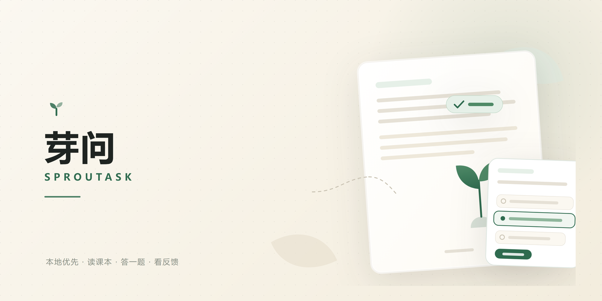
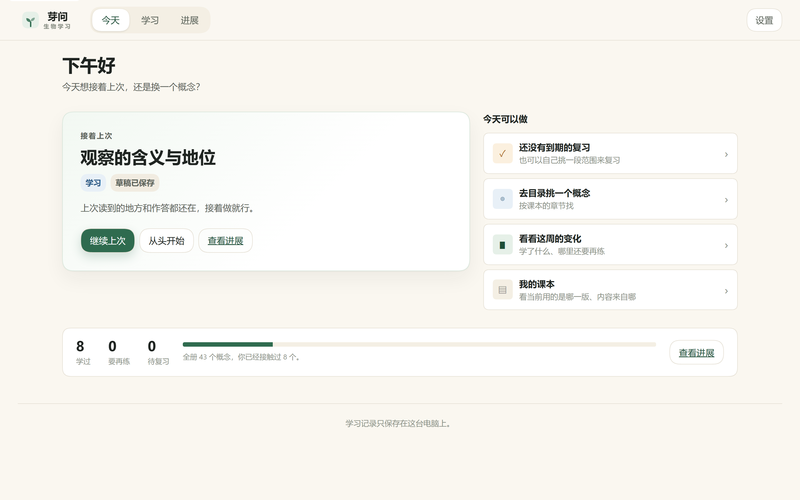
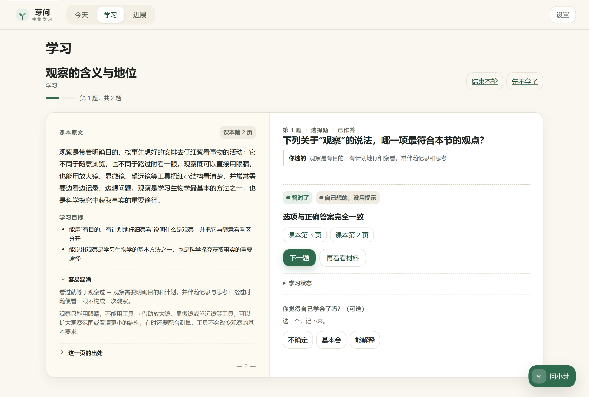
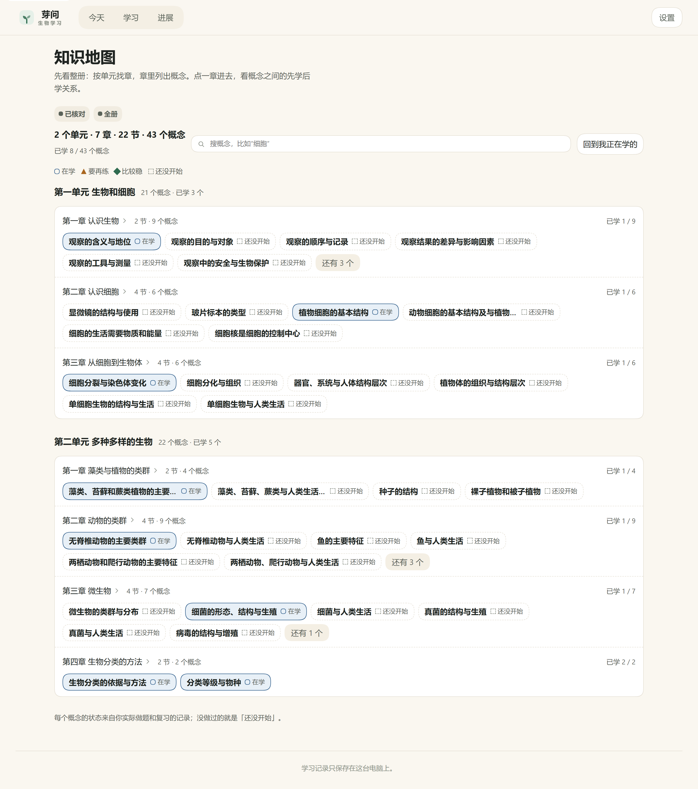

<p align="center">
  
</p>
<p align="center"><sub>设计示意图，非产品截图。</sub></p>

<h1 align="center">芽问 SproutAsk</h1>
<p align="center">给一名学生、一台 Windows 电脑用的本地优先生物学学习 Agent。</p>
<p align="center"><a href="README.md">English</a></p>

<p align="center">
  <a href="https://github.com/deepseek-ai/deepseek-harness"></a>
  <a href="https://www.typescriptlang.org/"></a>
  <a href="https://nodejs.org/"></a>
  <a href="https://pnpm.io/"></a>
  <a href="LICENSE"></a>
  <a href="https://github.com/HaoyanZhang123/sproutask/releases"></a>
</p>

## 简介

芽问是一个给一名学生、一台 Windows 电脑用的学习工作区。它把真实的 DSH Agent 会话与一套经过核对的人教 2024 七年级上册生物学内容包接在一起：学生读概念、作答，得到带课本出处的解释或纠错。

教材原文、草稿和学习记录都留在本机，云端只负责推理。界面用学生语言表达：左边读课本、右边答题，提交后原地给结论与出处；找概念用两级知识地图，而不是一屏设置。

## 核心特性

- **真实 DSH Agent 循环**：每一轮都经过 DSH 内核与受限教育工具；模型的回答不是教材内容的依据。
- **回答带出处**：解释回合附来源页，只显示本轮工具确实返回过的页码。
- **一张学习台**：左页课本、右页题目；提交后结论、依据和出处原地出现。窄于 1100px 时变成单页，课本收进抽屉。
- **两级知识地图**：先看全册章节总览，再看一章内的先修分层关系图；提供文字等价列表和键盘操作。
- **三条轴分开**：学习进程、理解证据、复习活动分别存储与显示；自评独立，永不写进判断。
- **本机优先的记录**：追加式事件日志 + 快照 + 崩溃恢复 + 导出与确认删除；不做教师端、不做班级聚合、不记姓名。
- **可恢复的会话**：草稿与位置保存在本机，重新打开回到同一道题。

## 安装

从 [Releases](https://github.com/HaoyanZhang123/sproutask/releases) 下载：

- `SproutAsk-Setup-0.4.0-x64.exe` —— **免管理员**的每用户安装包，装到 `%LOCALAPPDATA%\SproutAsk\current`
- `SproutAsk-0.4.0-x64-portable.zip` —— 解压后运行 `launcher.cmd`

安装包**未做代码签名**，Windows 会提示"未知发布者"；发布页附 `SHA256SUMS` 供校验。

## 使用方式

1. 从开始菜单或桌面快捷方式启动 **芽问**。
2. 打开 **设置**，粘贴 DeepSeek API Key。Key 在本机加密保存，之后不再回显；**重启应用**后生效。

   

3. 打开 **学习**：左边读课本，右边答题；提交后原地显示结论、依据和出处。

   

4. 打开 **知识地图**：按单元和章浏览全册，或查看一章内概念之间的先学后学关系。

   

5. **进展** 页回看学过什么、哪里要再练、哪些到期该复习；记录可以在本机导出或删除。

## 配置

| 项 | 值 |
|---|---|
| 模型 | DeepSeek 官方 API，仅 API Key（不提供账户登录） |
| Key 存储 | `%LOCALAPPDATA%\SproutAsk\data\secrets\model-key.dat`，DPAPI 加密，仅宿主侧 |
| 学习数据 | `%LOCALAPPDATA%\SproutAsk\data`（事件日志、快照、导入材料） |
| 网络 | 仅回环；本地服务不绑定公网接口 |
| 界面语言 | 简体中文 |

## 项目结构

```
education/packages/   domain、storage、importer、knowledge、learner、tutor、visuals
education/client/     无框架 DOM 界面：shell、study、map、library、visuals
education/runtime/    DSH host/client 插件、适配器、组合根、启动器
education/content/    biology-7a 内容包：概念、活动、评分、关系、出处
education/licenses/   第三方许可清单（含 libvips LGPL-3.0 义务）
docs/                 进度、架构、规范、重构交接包、发布说明
```

## 开发

```bash
pnpm --dir education install   # 只有 education/ 有依赖
pnpm dev                       # 本机 DSH web + Edge 应用窗口
pnpm typecheck
pnpm test
```

根目录的 `package.json` 是薄入口，命令全部转发到 `education/`。
架构见 `docs/ARCHITECTURE.md`，规范见 `docs/CONVENTIONS.md`，当前状态见 `docs/PROGRESS.md`。

## 发布

见 [Releases](https://github.com/HaoyanZhang123/sproutask/releases) 与 [v0.4.0 发布说明](docs/releases/v0.4.0.md)。

## 当前状态与已知限制

这是可用的学生版本，但仍有已知缺口，不是完成品。

- 门状态：G1（首节闭环）PARTIAL · G2（全册与教学）PARTIAL · G3（Windows 产物）PARTIAL · 最终验收**未达成**。
- 界面有自动测试、文案禁词守卫，并在 1440×900 / 1280×800 / 1024×768 做过截图走查；**没有做正式可用性实验**。
- 图义视觉核对只抽样 **8/73**；版次、印次、定价、ISBN 行在内容包中仍为 `unverified`。
- v0.4.0 未做干净机验证、未做代码签名、未做学习效果实验——不声称提升理解或成绩。
- 已知缺口：live 数据源暂不支持 `activityId`，「下一题」可能诚实降级为再答一次；自评尚未通过 shell API 落库；进展页的章节名与印刷页码映射还不完整。

## 许可证

MIT —— 见 [LICENSE](LICENSE)。Copyright (c) 2026 HaoyanZhang123。
